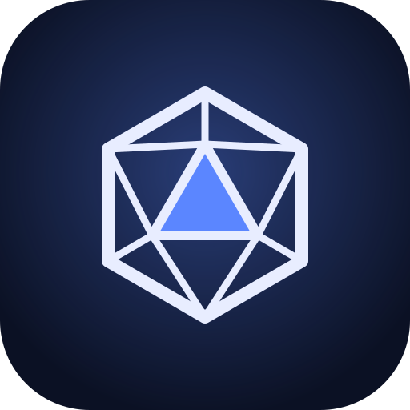

# Tabularium RPG

Fichas de RPG de mesa com **sessão ao vivo**: o Mestre acompanha a ficha de cada jogador em tempo real, a mesa rola dados em 3D, conversa no chat e ouve a música do Mestre. Gratuito, sem conta e sem servidor: os dados ficam no seu aparelho, e a mesa se conecta direto entre os participantes.


## Baixar

Na [página de versões](https://github.com/paulo-vc/tabularium/releases):

- **Windows:** o instalador (`.exe` ou `.msi`), ou o executável que roda sem instalar. No computador, o app se atualiza sozinho.
- **Linux:** `.AppImage`, `.deb` ou `.rpm`.
- **Android:** o `.apk`. Na primeira vez, o Android pede para permitir instalar de "fontes desconhecidas".

> No Windows, o aviso "O Windows protegeu seu computador" aparece porque o executável não tem assinatura digital paga. Clique em **Mais informações → Executar assim mesmo**.

O [guia de uso](docs/guia.md) mostra como mestrar, jogar e criar sistemas, com imagens.

## O que ele faz

- **Fichas** de D&D 5ª Edição (SRD 5.1) e **Lendas d20** (regras ORC), com os cálculos automáticos: modificadores, CA, perícias, carga, bônus de itens, maldições e bênçãos. Ataques, testes e dano rolam pela própria ficha; dá para imprimir ou salvar em PDF.
- **Sessão ao vivo:** o Mestre cria a campanha e manda o convite (link ou código curto). Cada jogador entra com a própria ficha, e o Mestre vê tudo mudar na hora, pode alterar as fichas e guardar campos secretos.
- **Combate:** ordem de turno com iniciativas, rodadas e criaturas ocultas; cada jogador recebe um aviso na vez dele.
- **Dados em 3D:** toda rolagem cai na tela e para na face sorteada; a mesa vê os dados de todos, cada um na sua cor. Histórico de rolagens no chat.
- **Chat:** falas de personagem, ações, rolagens com `/r` e sussurros; entre jogadores, cifrados de ponta a ponta.
- **Para o Mestre:** cutscene (imagens em tela cheia), música para a mesa, diário da campanha e rolagens secretas.
- **Criador de sistemas:** monte o seu sistema a partir de um modelo pronto, com fórmulas, dados próprios (como `4dF`) e prévia ao vivo, sem programar. Instale sistemas da comunidade e publique os seus.
- **Seus dados com você:** tudo fica no aparelho, com cópia de segurança completa para trocar de computador ou celular.


## Como a mesa se conecta

Os participantes se conectam **diretamente** (WebRTC), sem servidor do Tabularium no meio: é isso que mantém o app gratuito para todos. Serviços públicos só ajudam os aparelhos a se encontrarem. A conexão direta funciona na maioria das redes; em algumas (empresa, faculdade e, às vezes, o 4G), ela é bloqueada, e trocar de rede resolve. Detalhes em [Privacidade](docs/privacidade.md).

## Sistemas incluídos e licenças

- **D&D 5ª Edição (SRD 5.1):** inclui material do System Reference Document 5.1 da Wizards of the Coast LLC, sob a [CC-BY-4.0](https://creativecommons.org/licenses/by/4.0/legalcode).
- **Lendas d20 (ORC):** baseado no Player Core © 2023 Paizo Inc., sob a [ORC License](https://www.azoralaw.com/orclicense). Nomes, cenário e marcas da Paizo não são usados.

O Tabularium RPG não é afiliado, patrocinado nem endossado por nenhuma dessas empresas.

## Desenvolvimento

Pré-requisitos: **Node.js 24+** e **pnpm** (via `corepack enable pnpm`). Para o app de computador, também **Rust** ([rustup](https://rustup.rs)) e os [pré-requisitos do Tauri](https://tauri.app/start/prerequisites/). O APK do Android é gerado pelo workflow Android no GitHub.

```bash
pnpm install
pnpm dev            # o app no navegador, em http://localhost:5173 (para desenvolver)
pnpm desktop:dev    # o app de computador (requer Rust)
pnpm desktop:build:local  # instalador local, sem a assinatura de atualização
pnpm check          # tudo que o CI verifica
```

- [Guia de uso](docs/guia.md) · [Arquitetura](docs/architecture.md) · [Decisões (ADRs)](docs/adr/README.md) · [Formatos](docs/formatos.md) · [Fórmulas](docs/formulas.md) · [Roteiro](docs/roadmap.md) · [Como contribuir](CONTRIBUTING.md)

## Licença

Código sob [MIT](LICENSE). Os sistemas incluídos seguem as licenças indicadas acima.
