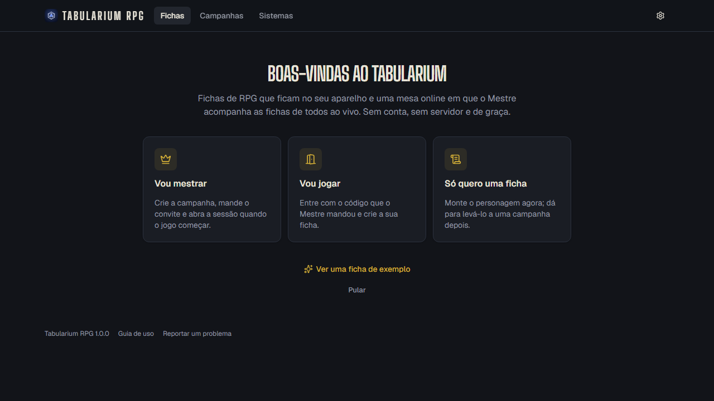
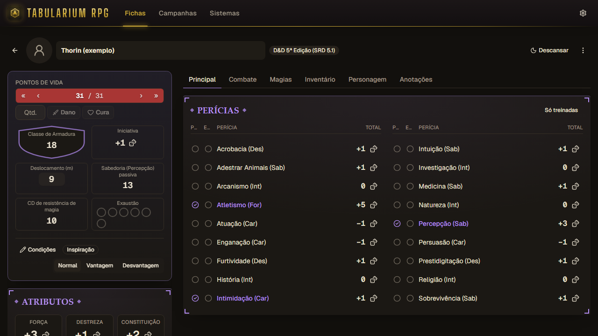
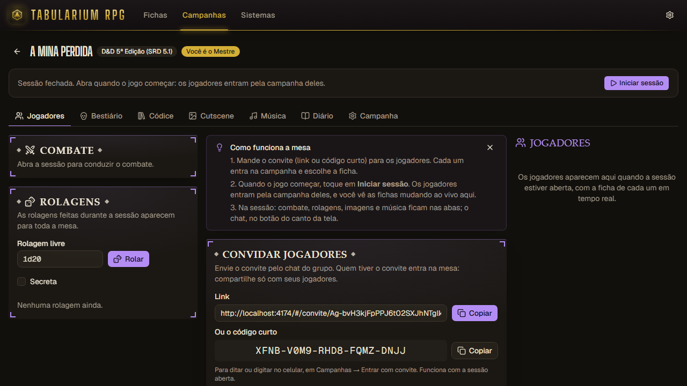
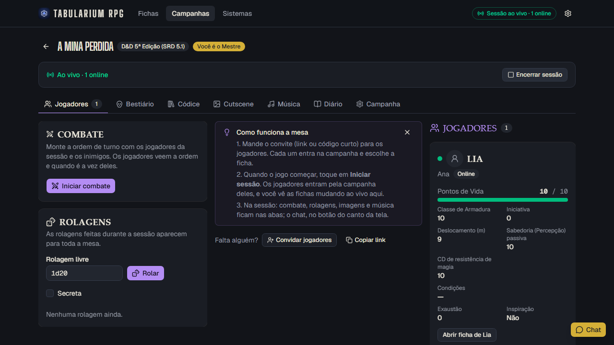
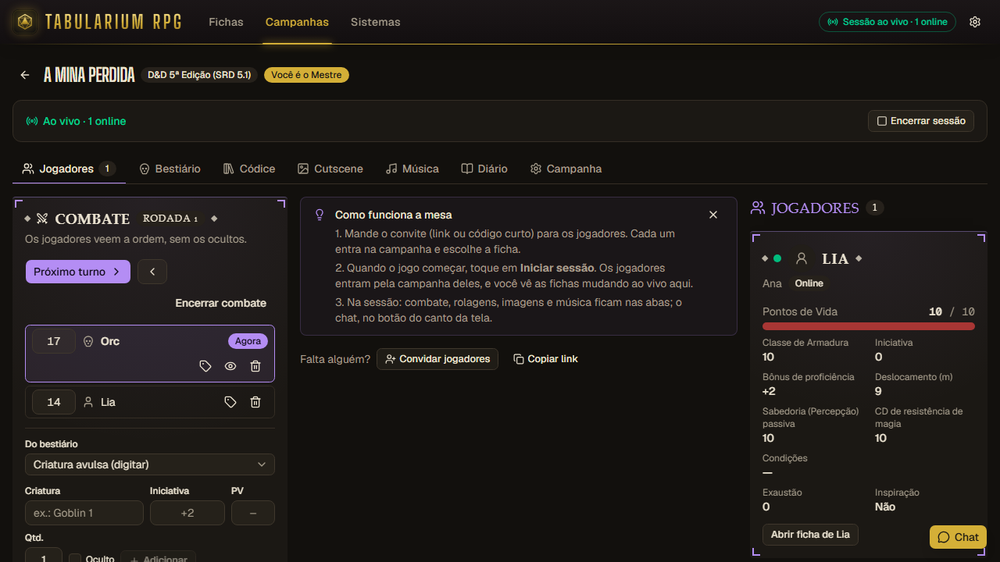
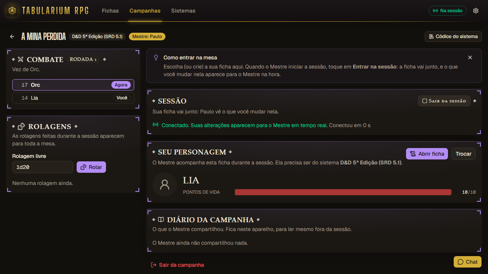
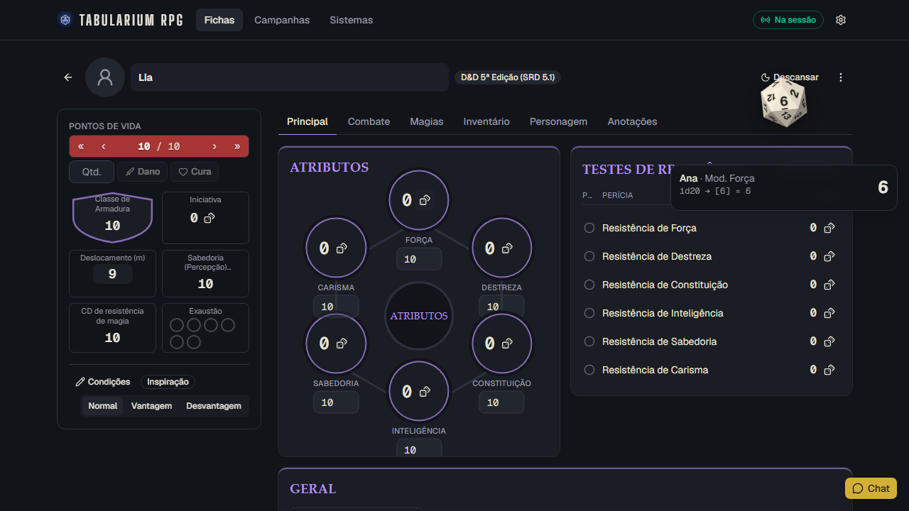
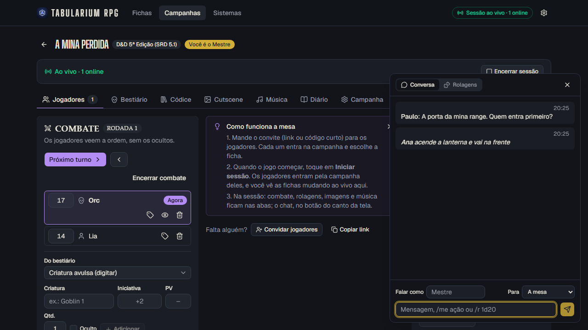
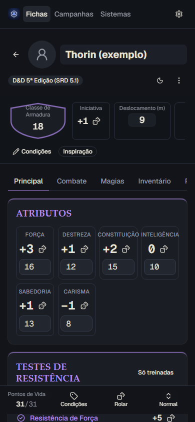
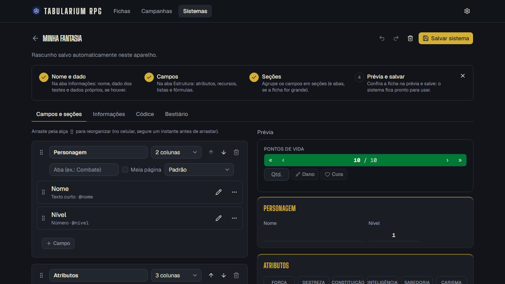

# Guia de uso

Como jogar com o Tabularium RPG: para quem mestra, para quem joga e para quem cria sistemas. Tudo fica no seu aparelho, sem conta.

- [Primeiros passos](#primeiros-passos)
- [Para o Mestre](#para-o-mestre)
- [Para o jogador](#para-o-jogador)
- [Na sessão](#na-sessão)
- [Para quem cria sistemas](#para-quem-cria-sistemas)
- [Não perder nada](#não-perder-nada)
- [Quando a conexão não abre](#quando-a-conexão-não-abre)

## Primeiros passos

Baixe o instalador do computador (Windows ou Linux) ou o APK do Android na [página de versões](https://github.com/paulo-vc/tabularium/releases). Na primeira vez, o app pergunta o que você quer fazer: mestrar, jogar ou só montar uma ficha. Se quiser só conhecer, abra a ficha de exemplo.

A ficha calcula sozinha o que depende de outros valores (modificadores, perícias, CA). Os botões de dado ao lado dos valores rolam o teste. PV e os outros recursos ficam no painel da ficha (no topo, ou numa coluna à esquerda em telas largas): −1 e +1 ajustam um ponto; para mais, digite a quantidade e toque em Dano ou Cura. No celular, a barra de baixo traz PV, condições, rolagem rápida e vantagem ao alcance do polegar. Na lista de ataques, **Ataque** rola o acerto e **Ataque + dano** rola os dois. Com vantagem ou desvantagem, escolha **Vantagem** ou **Desvantagem** no painel do topo antes de rolar: o próximo teste ou ataque rola dois d20 e fica com o maior ou o menor, e a escolha volta a Normal. No 20 natural, o **Ataque + dano** rola o dobro de dados no dano e marca "crítico". Depois de um descanso, toque em **Descansar**, no topo da ficha: a janela mostra o que volta (no D&D 5e, PV, espaços de magia, metade dos Dados de Vida, um nível de Exaustão) e recupera ao confirmar.

## Para o Mestre

1. Em **Campanhas**, toque em **Nova campanha**, dê um nome e escolha o sistema.
2. Mande o **convite** aos jogadores: o **código curto** de 20 letras, bom para ditar ou mandar no grupo (ele funciona com a sessão aberta), ou o **código completo**, que funciona a qualquer hora.
3. Quando o jogo começar, toque em **Iniciar sessão**. Os jogadores entram pela campanha deles, e você vê as fichas mudando ao vivo.

Na sessão, o Mestre também tem: o **combate** (ordem de turno, com criaturas ocultas que só ele vê e criaturas com PV, dano e cura em um toque), as **rolagens** (inclusive secretas), **cutscene** (imagens em tela cheia para a mesa), **música** (trilhas que tocam no aparelho de todos), o **diário** (notas só suas e entradas para a mesa) e a ficha de cada jogador, que ele pode alterar.

**Bestiário.** Na aba **Bestiário** da campanha ficam as criaturas: as que vêm com o sistema (o D&D 5e traz algumas do SRD) e as suas, criadas ali ou copiadas do sistema para ajustar. Cada uma tem PV, iniciativa, características, ataques e habilidades. No combate, escolha a criatura em **Do bestiário**: nome, iniciativa e PV já vêm preenchidos. Na ordem de turno, toque no PV para dar dano ou curar, e na ficha da criatura para rolar os ataques dela (se quiser, em segredo). Os jogadores veem só se ela está ilesa, ferida, muito ferida ou caída.

**Condições no combate.** O botão de etiqueta, em cada linha da ordem de turno, marca condições em quem está no combate, jogador ou criatura: as do códice do sistema num toque (no D&D 5e, Caído, Envenenado, Atordoado…) ou qualquer outra digitada ("Concentrado em Bênção"). Em **Duração**, escolha antes de marcar por quantas rodadas ela vale: a condição pega as próximas vezes do participante (contando a atual, se for a vez dele) e some sozinha quando a última termina; o número ao lado mostra as rodadas que faltam. A mesa toda vê. Tocando numa condição que tem página no códice, ela abre ali mesmo, para todos; na ficha, as condições marcadas abrem a página do mesmo jeito.

**Códice.** A aba **Códice** mostra as páginas de consulta do sistema (habilidades, regras, itens), com busca. Os jogadores leem pelo botão **Códice do sistema** na campanha, sem as páginas marcadas como "só o Mestre". O D&D 5e já traz as regras do SRD que mais se consultam na mesa: condições, ações em combate, cobertura, cair a 0 PV, descanso e testes.

## Para o jogador

1. Em **Campanhas → Entrar com convite**, digite o código curto ou cole o código completo que o Mestre mandou.
2. Escolha uma ficha sua ou crie uma nova, do sistema da campanha.
3. Quando o Mestre abrir a sessão, toque em **Entrar na sessão**. A ficha vai junto: o que você mudar nela aparece para o Mestre na hora.

Quando chega a sua vez no combate, o app avisa com uma faixa grande na tela e um som (e, no computador, o ícone pisca na barra de tarefas).

## Na sessão

**Dados.** Toda rolagem cai na tela em 3D, à direita, e para na face sorteada; a mesa vê os dados de todos, cada um na cor de quem rolou (escolha a sua em Configurações). Tocar num resultado abre o histórico de rolagens.

**Chat.** Fale como você ou como o personagem, descreva ações com `/me`, role com `/r 1d20+3` e sussurre a uma pessoa só. Os sussurros entre jogadores vão cifrados: nem o Mestre lê.

No celular, o app é o mesmo, com a ficha em uma coluna.

## Para quem cria sistemas

Em **Sistemas → Criar sistema**, comece de um modelo pronto (d20 ou 2d6), em branco, ou de uma cópia de um sistema que você já tem. O editor mostra as etapas e a prévia da ficha ao lado.

- **Campos:** números, textos, recursos (como PV), listas (ataques, inventário), escolhas e campos calculados por [fórmulas](formulas.md). O campo de fórmula traz exemplos prontos. Num campo calculado de teste, **Dados do teste** faz rolar tantos dados quanto outro campo (ex.: o atributo), ficando com o maior. Para uma regra opcional, use **Aparece na ficha**: o campo só aparece com um sim/não marcado (ou desmarcado), como a Determinação no lugar de PE e Sanidade.
- **Seções lado a lado:** marque **Meia página** numa seção para ela ficar ao lado da seguinte em telas largas, como os blocos de uma ficha de papel.
- **Dados do sistema:** dados com faces próprias, como o dado Fate (`4dF`) ou Esperança e Medo.
- **Ícone:** uma imagem pequena que aparece nas listas.
- **Códice:** páginas de consulta para a mesa (habilidades, regras, itens, magias), com títulos, listas, tabelas, negrito e links entre páginas (`[[Fúria]]`). Uma página pode ser só do Mestre: some para os jogadores, mas quem abre o arquivo do sistema ainda a vê. As páginas da categoria **Condições** viram as sugestões ao marcar condições no combate.
- **Bestiário:** as características que toda criatura do sistema tem (CA, Deslocamento…) e criaturas prontas, que o Mestre usa no combate. O sistema inteiro, com códice e bestiário, tem de caber em 450 KB, o tamanho que a sessão consegue enviar.
- **Importar:** em Sistemas → Importar sistema, escolha o arquivo ou cole o JSON (o exportado pelo app ou só o sistema). Os problemas aparecem com o lugar de cada um.

Para dividir com outras pessoas, exporte o sistema ou publique na comunidade (Sistemas → Explorar comunidade).

## Não perder nada

Tudo fica no aparelho. Em **Configurações → Cópia de segurança**, "Fazer cópia" guarda fichas, campanhas, sistemas e preferências num arquivo. Para trocar de computador ou de celular, restaure a cópia no aparelho novo: você continua sendo o Mestre das mesmas campanhas. A cópia leva a sua chave de Mestre, então guarde o arquivo só com você.

## Quando a conexão não abre

Os aparelhos da mesa se conectam direto, sem servidor no meio. Na maioria das redes funciona; em algumas (redes de empresa, faculdade e, às vezes, o 4G) a conexão direta é bloqueada. Para saber antes do jogo, use **Configurações → Conexão → Testar minha rede**: em alguns segundos o app diz se a sua rede conecta direto, se é restritiva (comum no 4G) ou se bloqueia a conexão. Se alguém ficar em "procurando o Mestre":

- troque de rede (o Wi-Fi de casa costuma funcionar);
- no 4G, quem estiver nele pode tentar compartilhar a internet do celular com o computador;
- confira se todos estão na mesma versão do app.

Mais detalhes sobre o que passa pela rede em [Privacidade](privacidade.md).
